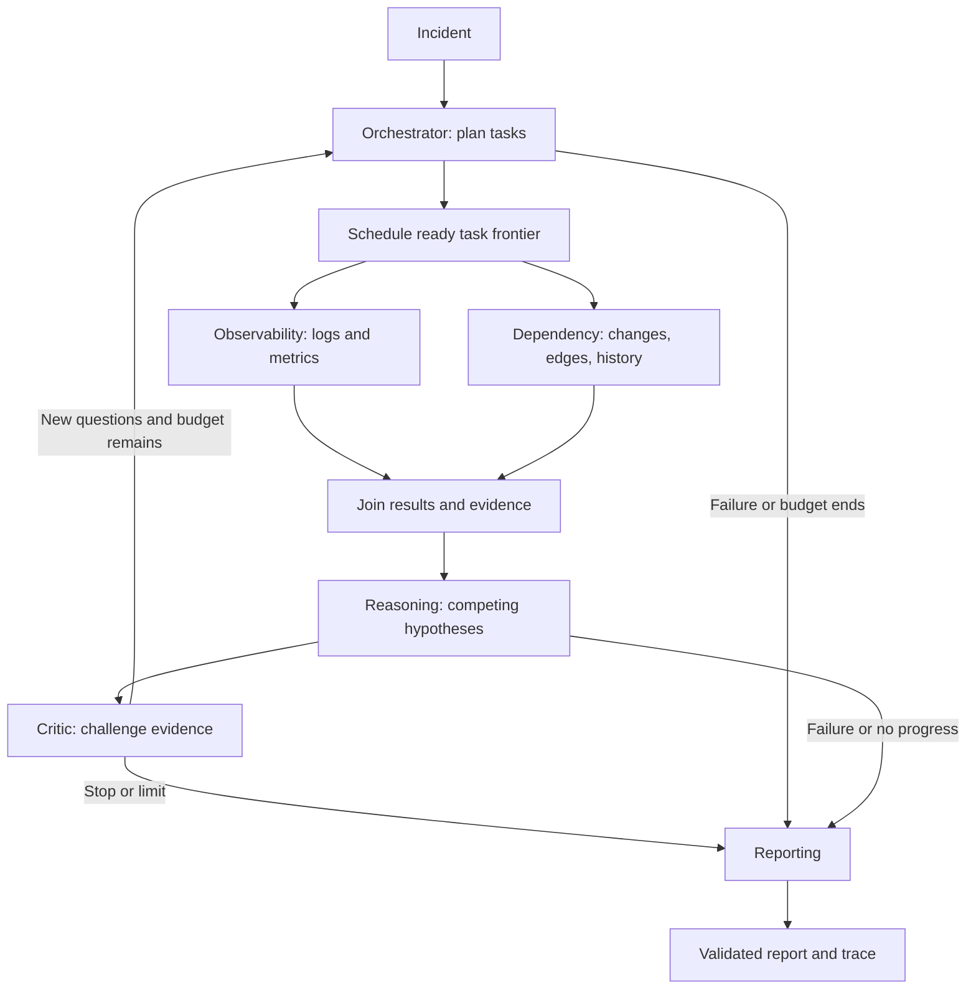

# IncidentLens

A local incident investigator with six collaborating Gemini roles, five evidence tools, a single-agent baseline and a streamed Next.js dashboard. Operational data is synthetic; recommendations are advisory.

[Demo video](results/demo/incidentlens-demo.mp4) · [Evaluation results](results/evaluation.md) · [AI transcripts](transcripts/README.md) · [Technical note](TECHNICAL_NOTE.md)

## Run locally

Verified on Node 24.11.1 and npm 11.6.2. Use Node 24.

```sh
npm ci
# Fresh checkout only; preserve an existing .env.local:
cp .env.example .env.local
```

Set these server-only values in `.env.local`:

```dotenv
GEMINI_API_KEY=<your Google AI Studio key>
GEMINI_MODEL=gemini-3.5-flash-lite
GEMINI_THINKING_LEVEL=low
```

LangGraph runs locally without an account or key. LangSmith is optional and disabled. Only Gemini access and available project quota are needed; credentials stay on the server and `.env.local` is ignored by Git.

```sh
npm run dev
# Open http://localhost:3000
```

Choose an incident and mode, then Investigate. The graph and activity feed show actual progress; report citations open retrieved raw evidence. Cancel aborts the run. Dashboard runs are temporary and disappear on refresh/restart; CLI runs save traces.

## Test and build

```sh
npm test
npm run typecheck
npm run build
npm start
```

The 148 automated tests mock provider calls and do not consume API quota. Typecheck generates Next route types. Build uses webpack; start serves the production build at port 3000. Stop any development server using that port first.

```sh
npm run investigate -- --list
INCIDENTLENS_MODEL_INTERVAL_MS=4500 npm run investigate -- inc-001
INCIDENTLENS_MODEL_INTERVAL_MS=4500 npm run investigate -- inc-001 --single-agent
npm run evaluate -- --dry-run
```

List and dry-run make no model calls. Investigations call Gemini and save JSON traces under `results/traces/`; progress goes to stderr and the report to stdout. Ctrl-C cancels. Use one model-facing process at a time because independent CLI processes have separate pacers. Dashboard requests share at least 4,500 ms model-start spacing.

## Architecture and coordination



`lib/investigation.ts` uses a real LangGraph StateGraph. The Orchestrator selects a task DAG; independent specialist tasks run concurrently and dependants wait for completed prerequisites. Each frontier joins before findings merge. Shared state contains tasks, retrieved evidence, findings, hypotheses, assumptions, unknowns, critic requests, events, failures and usage. Critic requests retain exact IDs, roles and questions through replanning. Cyclic dependencies, repeated follow-up queries and no-progress loops are rejected.

`lib/agents.ts` shares a typed LangChain runner with role-specific tool access and Zod results. Native ChatGoogle gathering and structured output use separate requests; original message IDs and thought signatures survive tool round-trips in memory. Logs and historical reports are untrusted data. Reporting preserves assessed hypotheses, confidence and contradictions in the host. Facts/actions require retrieved citations; inadequate corroboration or unresolved critic requests constrain the outcome to inconclusive. Remediation is never executed.

The five tools query logs, metrics, changes, active dependency edges and historical incidents. Envelopes distinguish empty searches, truncated results and unavailable sources. `data/` contains ten incidents and 116 timestamped records. Evaluation labels and resettable failure schedules remain outside agent inputs. There are no per-case answer lookups.

The baseline uses one general Investigator with the same tools, model, budgets and accounting; it can gather and revise repeatedly. It has no specialists or separate critic. Role-failure admissions collapse to Investigator ordinals as disclosed in the evaluation manifest.

## Reliability

Both modes default to two rounds, 20 model/tool attempts, a 120-second deadline, 20-second request timeout, 2,048 output/thinking tokens per request and 64,000 reported tokens per run. Reporting reserves 25 seconds, 12,288 tokens and three attempts inside those limits. See `.env.example` for overrides.

Model requests allow at most three total attempts, including one output repair; SDK retries are disabled. Retryable tools get one retry. Failed and repaired attempts consume budgets. Cancellation propagates to model/tools. Unrecovered failures produce explicit inconclusive reports. Admission estimates and partial provider usage prevent guaranteeing an exact actual-token ceiling; unknown usage stays null and known totals may be subtotals.

## Evaluation

[The recorded comparison](results/evaluation.md) covers all ten incidents in both modes, including the failed execution:

| Metric | Multi-agent | Single-agent |
| --- | --- | --- |
| Successful executions | 10/10 | 9/10 |
| Strict root-cause accuracy | 5/9 | 8/9 |
| Correct expected-inconclusive outcome | 1/1 | 0/1 |
| Grounding, per-case macro | 90.7% | 71.3% |
| Citation validity, per-case macro | 100% | 100% |

The baseline sparse-case execution exhausted retries on Gemini 503. Successful execution is separate from a correct root cause; multi-agent accuracy was lower. Per-case reports, tool calls, latency, usage and separate judge accounting are included. Primary accuracy requires a successful concluded execution with a held-out acceptable cause-class/component pair; failed/missing runs receive zero credit. Expected-inconclusive accuracy is separate. Grounding checks selected factual sentences against cited records; citation validity only checks reference resolution. Automated judgments and ten synthetic cases give limited evidence.

**Remaining validation:** this comparison predates the final citation/reporting fixes. Its matching source snapshot is in `results/source/`, and the dashboard marks the comparison stale. Later focused tests completed 3/4 investigations; the sparse multi-agent run reached its attempt budget after a 503. A grounding-checker schema regression was fixed and tested offline. Its live retry and a complete final-revision comparison remain outstanding after the approved 480-request test cap. These limits are not presented as passing results.

For a new comparison, check your active free-tier project quotas, choose a fresh output directory and supply the verified policy:

```sh
INCIDENTLENS_MODEL_INTERVAL_MS=4500 npm run evaluate -- --run --output results/new-evaluation --tier free --quota-policy '<verified free RPM/TPM/RPD and reset policy>' --pause-ms 1000
```

Resume adds `--resume` with identical code/configuration/policy. `--retry-incomplete` retries missing-result investigations and incomplete judgments; saved reports, including failures, are reused. Checkpoints are atomic and writer-locked. Exit 1 indicates an incomplete execution or judgment. Model-facing commands consume Gemini quota; no paid fallback is configured.

## Repository contents

- `app/`, `components/`: dashboard and streamed API.
- `lib/`, `data/`: investigation engine and synthetic evidence.
- `evaluation/`, `tests/`: baseline comparison and automated tests.
- `results/`: comparison, supporting reports/traces, tested source snapshot and requested demo.
- `transcripts/`: faithful readable coding conversations, with original speakers and privacy redactions.
- `TECHNICAL_NOTE.md`: decisions, trade-offs, limitations and improvements, under 500 words.

The [87-second demo](results/demo/README.md) shows an actual passing investigation with waiting periods shortened. It is selected footage. Transcripts are text-only exports; omitted tool payloads and workspace context are documented in their index. Local credentials, dependencies and build caches are excluded by `.gitignore`.
